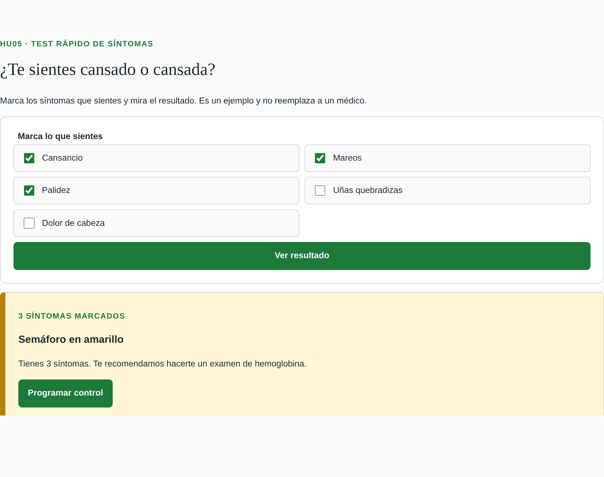
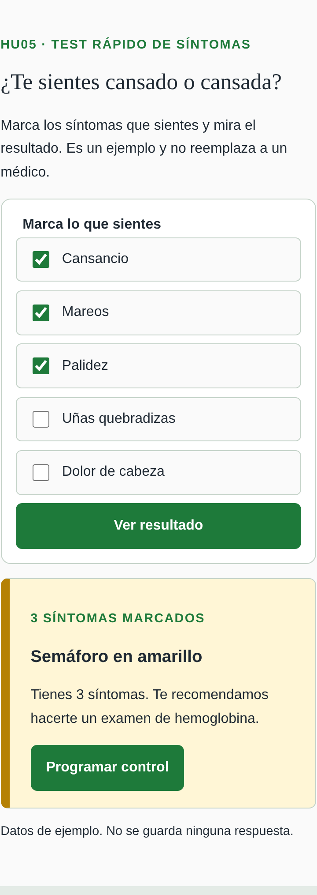
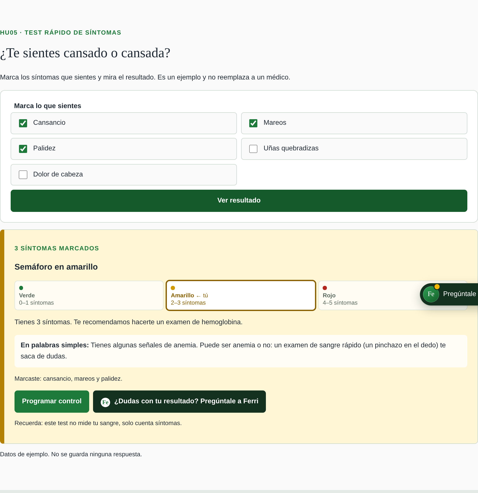
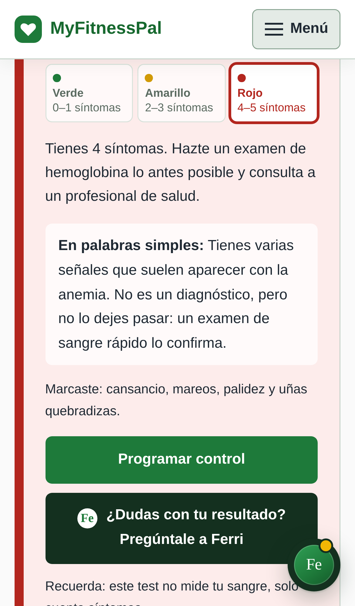
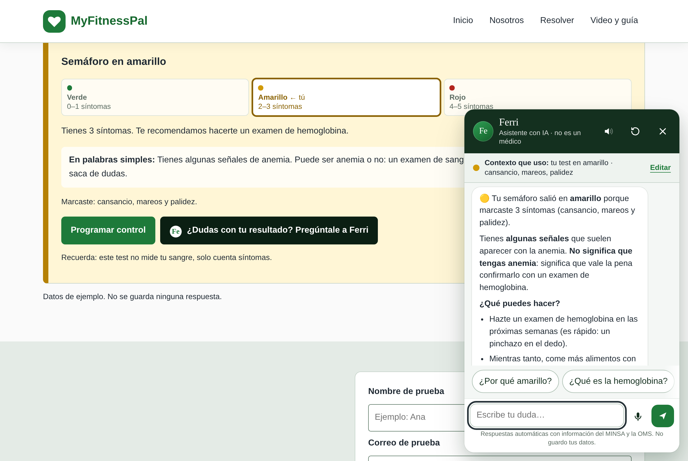
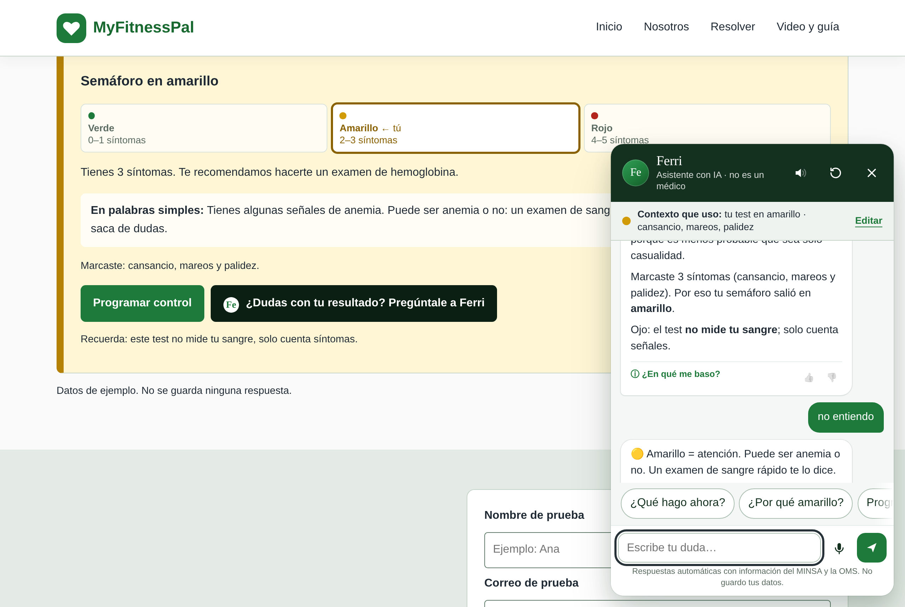
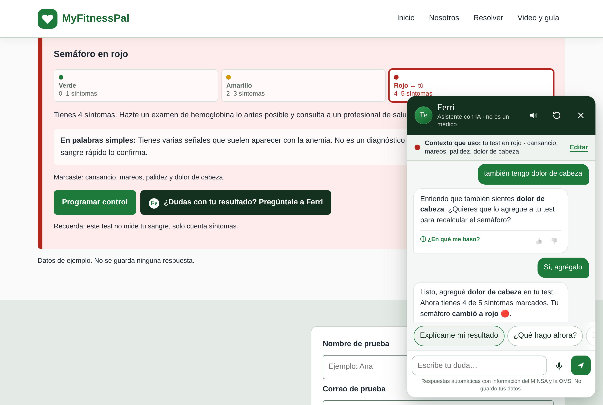
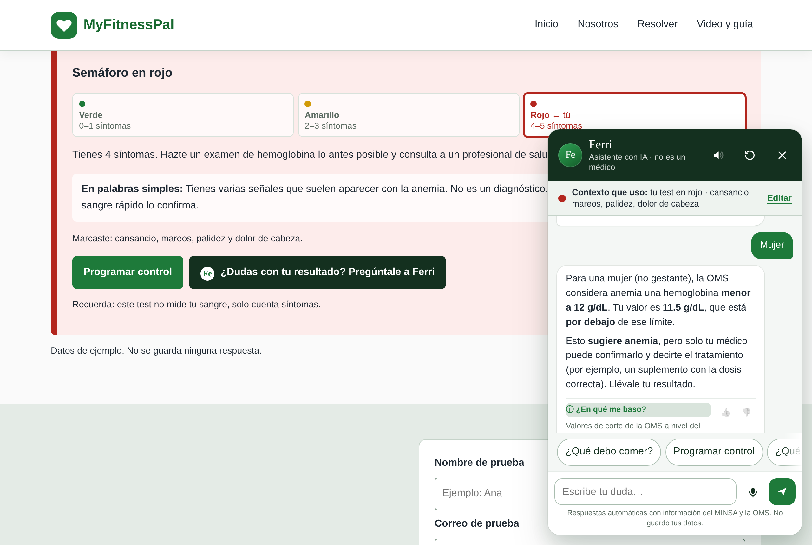
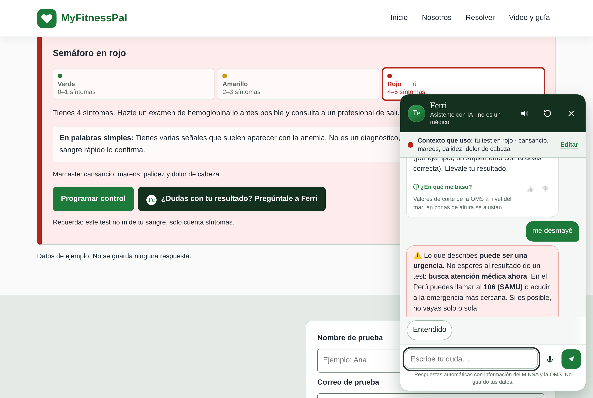
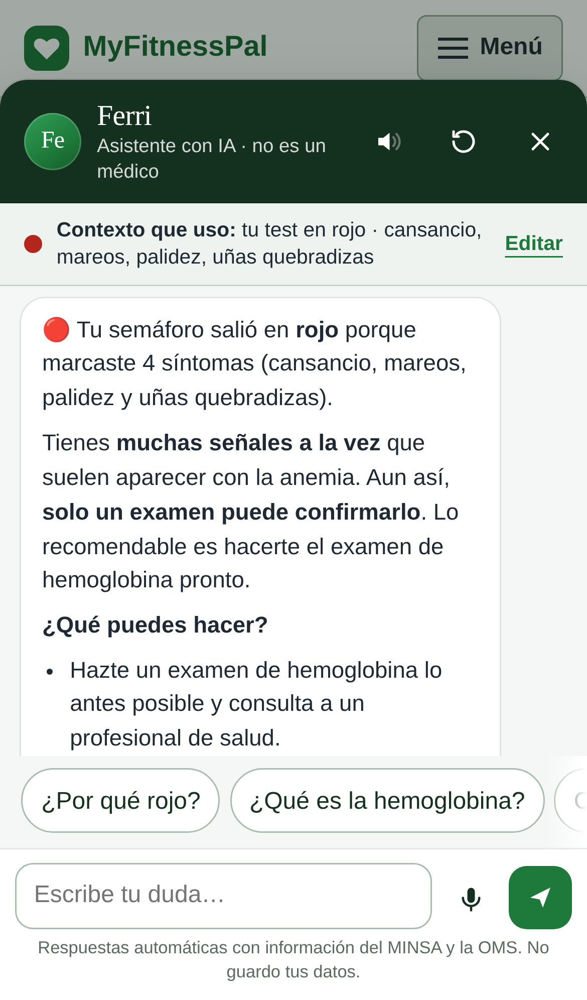

# Paso 2 · Mejora individual: Ferri, asistente conversacional del test de síntomas

## 1. Problema identificado en la evaluación de usabilidad
**P1:** los usuarios **no entendían el resultado del test de síntomas** (HU05). Al ver "Semáforo en amarillo · Tienes 3 síntomas" se preguntaban:
- ¿Eso significa que tengo anemia?
- ¿Por qué salió amarillo y no rojo?
- ¿Qué es la hemoglobina y dónde me hago ese examen?
- ¿Y ahora qué hago?

La interfaz no respondía ninguna de esas preguntas. Se incumplían las heurísticas **H2** (lenguaje del usuario), **H10** (ayuda) y **H1** (visibilidad del estado).

## 2. Solución propuesta y justificación
**Ferri** (de *Fe*, el símbolo químico del hierro) es un **asistente conversacional** que conoce el resultado del test y lo explica conversando, con texto o con voz.

¿Por qué un chatbot y no solo más texto en la página?
- Cada usuario tiene una duda distinta (qué significa, por qué, qué hacer, qué comer). Un texto fijo largo nadie lo lee; un diálogo responde **justo la duda que tiene cada persona**.
- Puede **repetir con palabras más simples** cuando el usuario dice "no entiendo". Ese era el problema de fondo.
- Acompaña la decisión (hacerse el examen) y lleva a la acción (programar el control) sin salir de la conversación.

Además, se hicieron **dos ajustes pequeños** en la caja del resultado, para quien no quiera conversar:
- una **escala del semáforo** (verde 0–1 / amarillo 2–3 / rojo 4–5) que marca "← tú";
- una línea **"En palabras simples"** y la lista de síntomas marcados.

## 3. Mejora implementada y tecnología

| Componente | Archivo | Qué hace |
|---|---|---|
| Motor conversacional (NLU + diálogo) | `js/ferri-motor.js` | Entiende lenguaje natural (tolera errores de tipeo), extrae entidades (síntomas, alimentos, valor de hemoglobina, grupo), recuerda el contexto y pide los datos que faltan. |
| Base de conocimiento | `js/ferri-conocimiento.js` | Textos en 4 niveles (normal, simple, *¿por qué?*, *más*) con fuentes del MINSA y la OMS. |
| Interfaz del chat + voz | `js/ferri-chat.js`, `css/ferri.css` | Panel accesible; **reconocimiento de voz** 🎤 y **lectura en voz alta** 🔊 (Web Speech API, es-PE). |
| Integración con el test | `js/test-sintomas.js`, `index.html` | El test comparte su resultado con Ferri, y Ferri puede marcar o desmarcar casillas si el usuario se lo pide. |
| Conexión opcional a un LLM | `js/ferri-config.js`, `docs/BOTPRESS.md` | Modo Botpress Cloud, con vuelta automática al motor local si falla. |

**Interfaz emergente:** multimodal, **texto + voz** (dictado y respuesta hablada). Si el usuario habla, Ferri le responde también en voz y lo avisa ("🔊 para apagar").

### Principios de Interacción Humano-IA aplicados

| Principio | Cómo se ve en Ferri |
|---|---|
| **Transparencia** | Se presenta como "Asistente con IA · no es un médico". La franja **"Contexto que uso"** muestra qué datos del test está leyendo. Cada respuesta tiene **"ⓘ ¿En qué me baso?"**, con la razón y la fuente. |
| **Control del usuario** | **Pregunta antes** de cambiar el test ("¿Quieres que lo agregue?"). Tiene **Deshacer**, botón para **borrar la conversación** y para **apagar la voz**, y un enlace **Editar** para volver al test. Nada se hace sin confirmación. |
| **Confianza** | No diagnostica: dice "no lo sé, y el test tampoco puede saberlo" y explica los límites del test. Las respuestas están revisadas y vienen del MINSA/OMS. Ante señales de urgencia (desmayo, dolor de pecho) deriva al **106 (SAMU)**. |
| **Recuperación ante errores** | Si no entiende, **no inventa**: ofrece opciones ("¿Quisiste decir…?"). 👎 en una respuesta la vuelve a explicar en palabras simples. Si falla el micrófono, explica por qué y deja escribir. Si Botpress no carga, vuelve al motor local. |

### Accesibilidad y calidad de interacción
- Navegable con teclado (Esc cierra y devuelve el foco), `role="dialog"` y `role="log"` con `aria-live` para lectores de pantalla.
- Movimiento según las skills de **emilkowalski/skills**: solo `transform`/`opacity`, curvas *ease-out*, panel que crece desde su botón, `:active` con escala, *hover* solo con mouse y `prefers-reduced-motion`.
- En celular: hoja inferior, campo de 16 px (sin zoom en iOS), áreas seguras del notch y sugerencias en una fila deslizable.
- Privacidad: la conversación vive solo en la pestaña (`sessionStorage`); en modo local no se envía nada a servidores.

## 4. Comparación antes / después

### Antes
| Escritorio | Celular |
|---|---|
|  |  |

### Después: resultado del test
| Escritorio | Celular |
|---|---|
|  |  |

### Después: conversación con Ferri
| | |
|---|---|
| 1. Explica el resultado con el contexto del test  | 2. "¿Por qué amarillo?" → "no entiendo" (lo dice más simple)  |
| 3. Control del usuario: pregunta antes de cambiar el test  | 4. Interpreta la hemoglobina y muestra en qué se basa  |
| 5. Seguridad: detecta una urgencia  | Celular  |

## 5. Verificación
- **66 de 66** pruebas automáticas de conversación correctas (`node tests/probar-ferri.js`). Cubren: explicar el resultado, *¿por qué?*, *no entiendo*, cambiar el test con confirmación, hemoglobina con datos faltantes, alimentos, urgencias, errores de tipeo y mensajes sin sentido.
- Probado en Chromium de escritorio (1280 px) y en un iPhone 13 emulado, sin errores en la consola.
- El contexto se conserva al pasar de `index.html` a `recursos.html` en la misma pestaña.
