# Paso 2 · Mejoras implementadas (problema, solución, tecnología y antes / después)

Cada mejora está en su propio archivo. Todas funcionan en GitHub Pages, sin servidores ni claves.

---

## 1 · Voz en Recordatorios
**Problema:** el formulario pide 5 campos y un checkbox; en el celular es incómodo.
**Solución:** un botón **🎤 Dictar recordatorio**. Dices *"suplemento de hierro, todos los días, a las 8"* y se llenan "¿Qué quieres recordar?", "¿Cada cuánto?" y "¿A qué hora?". También entiende el nombre ("me llamo Ana") y el correo dictado ("ana arroba gmail punto com"). Si no hay micrófono, se puede **escribir la misma frase**.
**Justificación:** convierte 5 decisiones en una frase natural. Es la única mejora con voz del equipo.
**Tecnología:** Web Speech API (reconocimiento de voz `es-PE`) más un intérprete propio de la frase. Archivos: `js/voz-recordatorio.js`, `css/mejoras.css`.

| Principio | Cómo se ve |
|---|---|
| Control del usuario | **Nunca envía solo.** Muestra "Escuché: …" y lo que llenó (✓), con **Deshacer relleno**. La casilla "Entiendo que es una simulación" la marca la persona. |
| Recuperación ante errores | Dice lo que **no** entendió ("No entendí la hora…"). Si la hora no existe (las 7), elige la más cercana y lo avisa. Si el micrófono falla, explica por qué y deja escribir. |

| Antes | Después |
|---|---|
| 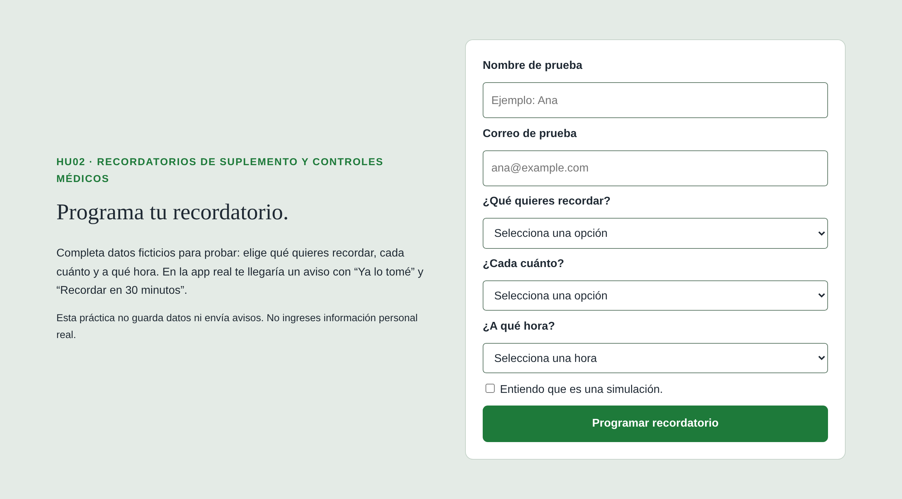 | 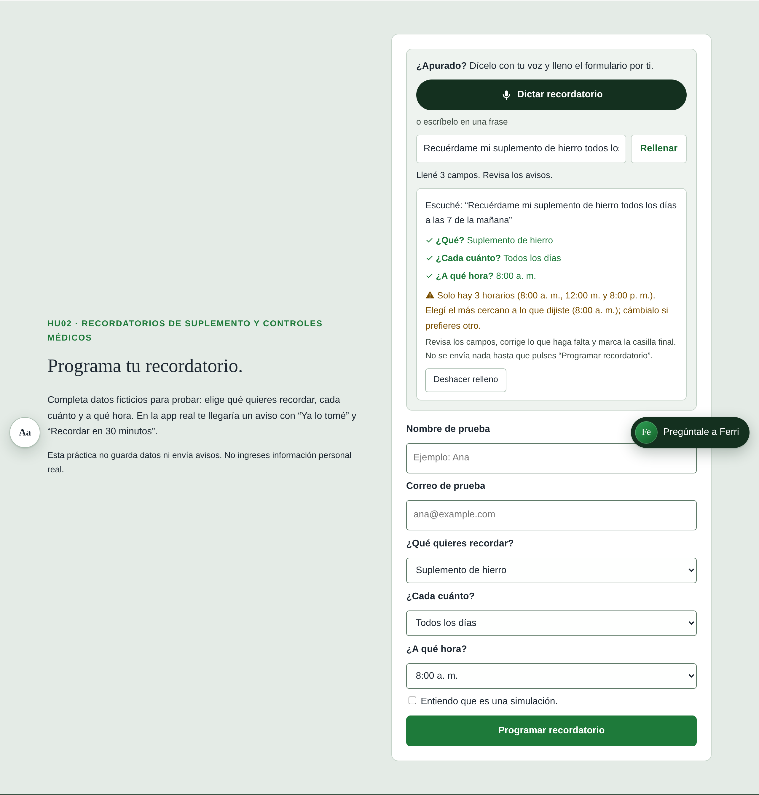 |

---

## 2 · Asistente conversacional: Ferri (texto + imágenes)
**Problema:** "mg", "meta de 18 mg" o "absorción" no se explican y no hay a quién preguntar.
**Solución:** **Ferri** (por *Fe*, el símbolo del hierro), un chat flotante **solo de texto** que responde **solo dudas sobre anemia y hierro**: qué es mg, la meta de 18 mg, la absorción, el hierro hemínico, la hemoglobina y el resultado del test de síntomas. Junto a esos términos aparecen botones **"¿Qué significa mg?"** que abren a Ferri con la pregunta ya hecha.
**Imágenes 📎 (multimodal):** se puede adjuntar, pegar o arrastrar una imagen y Ferri la **lee** y la **ve**:
- **resultado de laboratorio** → lee "Hemoglobina 11.2 g/dL" (también en g/L) y lo interpreta según el grupo (pregunta si es mujer, varón, gestante o niño);
- **etiqueta nutricional** → lee "Hierro 4.5 mg" y calcula el % de la meta de 18 mg;
- **caja de suplemento** → reconoce "sulfato ferroso" y explica el uso sin dar dosis;
- **foto del plato** → estima los alimentos por colores, con su confianza.

Muestra "Texto que leí" en "¿En qué me baso?". **La imagen no sale del dispositivo.**

**Para no invadir a los demás:** si le piden un menú o un recordatorio, responde que eso está en su sección (no lo hace él).
**Tecnología:** motor conversacional propio en el navegador (entiende la intención, tolera errores de tipeo, recuerda el contexto para "¿por qué?", "no entiendo" o "más"). Para las imágenes usa **Tesseract.js** (lectura de texto, OCR, en español), incluido en `vendor/tesseract/` y cargado solo cuando se adjunta una imagen, más el análisis de colores de la mejora 5. Archivos: `js/ferri-*.js`, `css/ferri.css`. Botpress (LLM) queda como modo opcional (`docs/BOTPRESS.md`).

| Principio | Cómo se ve |
|---|---|
| Transparencia | "Dudas sobre anemia y hierro · **no reemplaza al médico**" en la cabecera y en el pie. **ⓘ ¿En qué me baso?** en cada respuesta, con la fuente (MINSA/OMS). |
| Confianza | No diagnostica ni inventa: si no entiende, ofrece opciones. Ante una urgencia ("me desmayé") deriva al 106. 👎 vuelve a explicar más simple. |

| Antes (términos sin explicar) | Después |
|---|---|
| 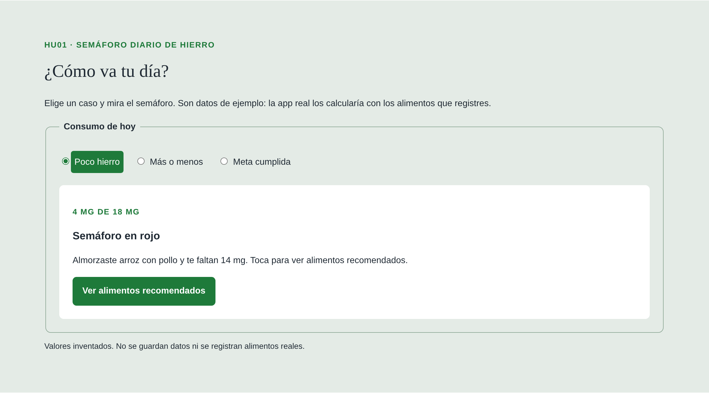 | 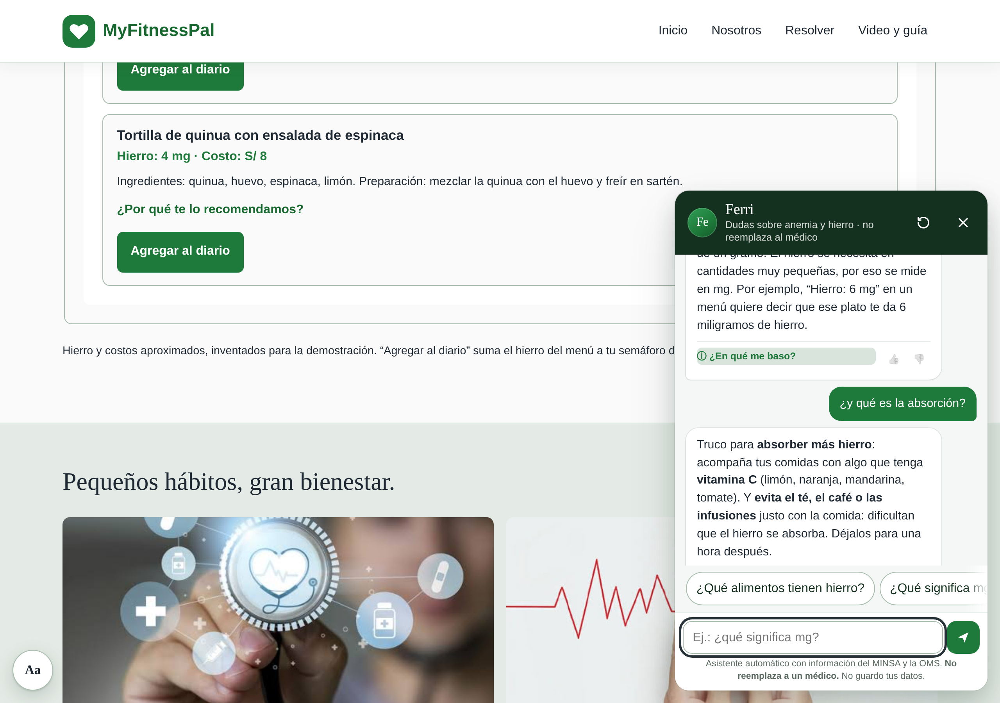 |

Límites claros (no programa recordatorios): 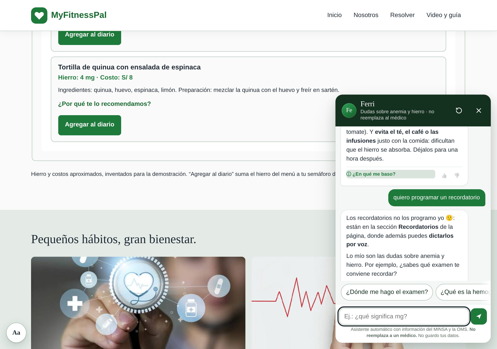

---

## 3 · Recomendaciones personalizadas en Menús
**Problema:** los menús eran iguales para todos, sin considerar gustos ni restricciones.
**Solución:** filtros **Soy vegetariano/a · No como hígado ni sangrecita · No como pescado · No como huevo · Me gustan las menestras**. Según el presupuesto (S/ 10, 15, 20) se recomiendan los 3 menús con más hierro que cumplen las preferencias. Cada uno tiene **"¿Por qué te lo recomendamos?"** y **Agregar al diario** suma su hierro al semáforo. Se añadieron 2 menús vegetarianos (marcados "Nuevo") para que esa opción no quede vacía.
**Tecnología:** recomendación basada en reglas (filtrar, puntuar y ordenar) con explicación generada para cada menú. Las preferencias se recuerdan solo en el navegador. Archivo: `js/menus-personalizados.js`.

| Principio | Cómo se ve |
|---|---|
| Transparencia | Cada menú explica: % de la meta de 18 mg, costo dentro del presupuesto, qué preferencia cumple y cómo se absorbe su hierro. Dice cuántos menús ocultó y por qué. |
| Control del usuario | El usuario elige sus filtros, con **Quitar filtros** y **Ver todos**. Si nada cumple, lo dice y sugiere subir el presupuesto. |

| Antes | Después |
|---|---|
| 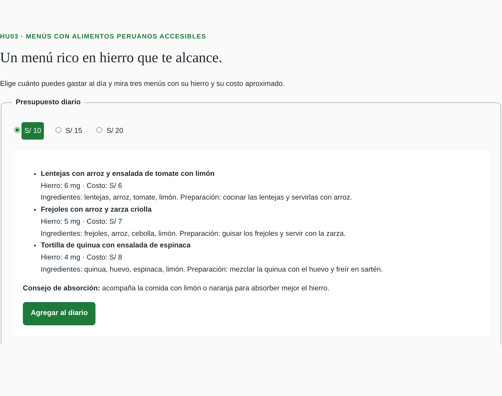 | 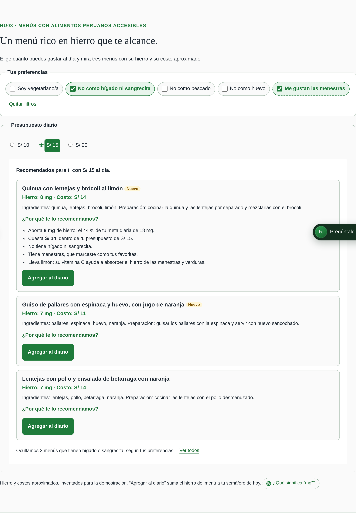 |

---

## 4 · Gestos en el video (recursos.html)
**Problema:** el video solo se controlaba con los botones pequeños del reproductor.
**Solución (solo gestos y teclado, sin voz):**
- **Doble toque** a la izquierda o derecha: −10 / +10 s (con un destello en ese lado).
- **Un toque** al centro: reproducir o pausar.
- **Mantener presionado**: 2× mientras se mantiene.
- **Doble toque** al centro: pantalla completa.
- **Teclado:** K/Espacio, J/L, ←/→, ↑/↓, M, F, < >, 0–9.
- Un **aviso visible** de cada acción ("⏩ +10 s · 0:10") y la lista de gestos a la vista.

**Tecnología:** Pointer Events (toque y mouse con la misma lógica) y la API de `<video>`. Archivo: `js/video-gestos.js`.

| Principio | Cómo se ve |
|---|---|
| Control del usuario | Varias formas de hacer lo mismo (botones nativos, gestos o teclado). El gesto de mantener se deshace al soltar. |
| Retroalimentación | Aviso en el centro del video para cada acción. Las acciones con teclado se muestran sin animación (más rápidas). |

| Antes | Después |
|---|---|
| 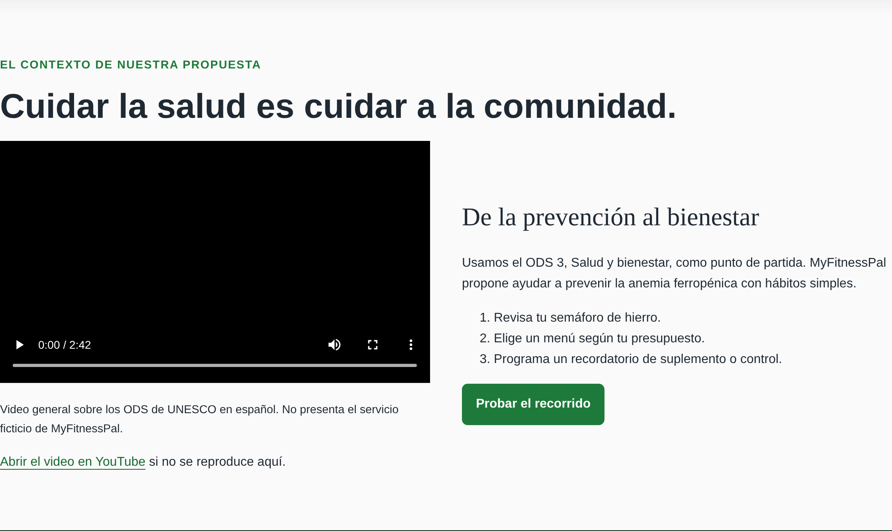 | 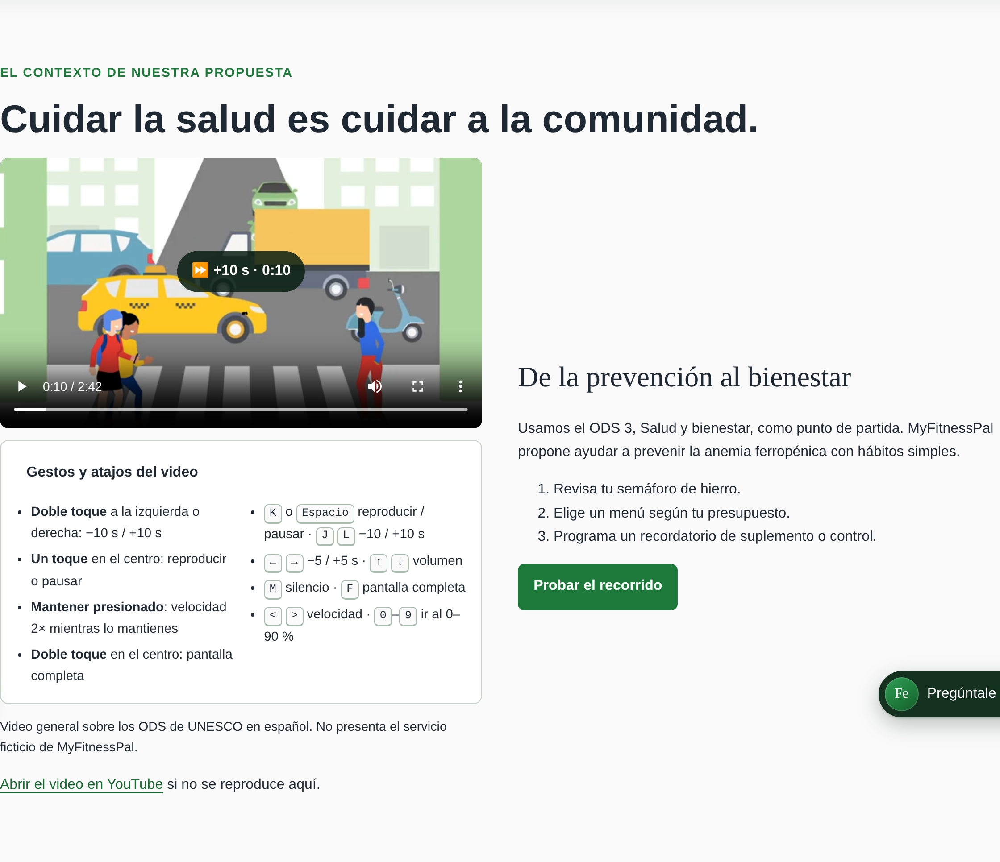 |

---

## 5 · Reconocimiento de imágenes en el Semáforo de hierro
**Problema:** solo se podía elegir entre 3 casos fijos; no se podía registrar lo que uno comió.
**Solución:** **Subir foto del plato**. Se proponen los alimentos con su **confianza** y su origen ("color marrón en el 32 % de la foto" o "nombre del archivo"). Cada alimento se puede **cambiar** (menú desplegable), **quitar** (✕) o **agregar** desde una lista. Luego se suman al **diario de hoy**: "X mg de 18 mg", con barra y semáforo rojo, amarillo o verde.
**Simulación, como permite la guía:** el reconocimiento es una **estimación por colores** (rojo oscuro = hígado o sangrecita, marrón = menestras, verde = espinaca…) más el nombre del archivo. Corre en el celular y **la foto no se sube a ningún servidor**.
**Tecnología:** Canvas (lectura de píxeles y colores en HSV). Archivo: `js/plato-foto.js`.

| Principio | Cómo se ve |
|---|---|
| Transparencia | Qué detectó, con qué confianza (barra y %) y cómo lo dedujo. El aviso dice que es una estimación. Si la foto tiene mucho blanco, avisa que "podría ser el plato". |
| Recuperación ante errores | Corregir, quitar o agregar alimentos antes de sumar. "Descartar foto". Quitar entradas del diario o "Empezar el día de cero". En un plato vacío no inventa comida. |

| Antes | Después: análisis | Después: diario |
|---|---|---|
|  | 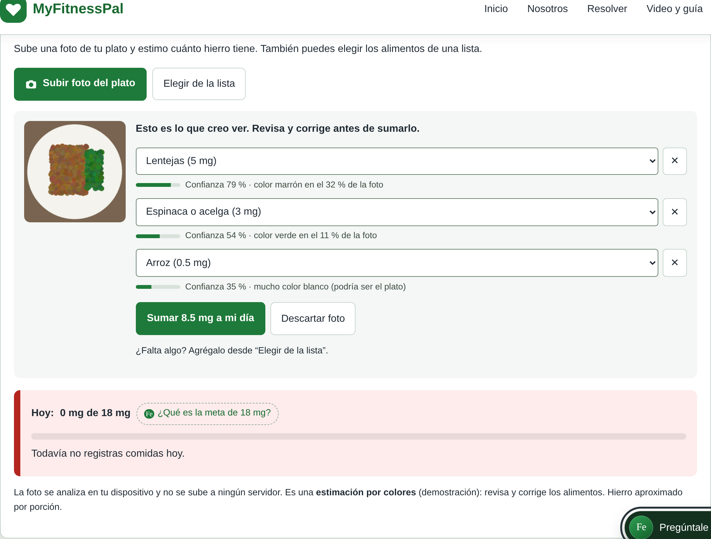 | 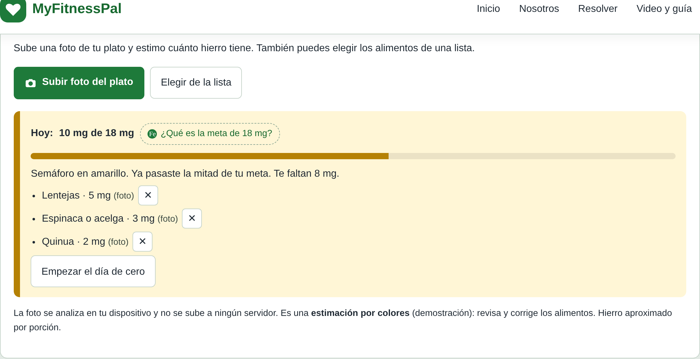 |

---

## 6 · Interfaz adaptativa al dispositivo
**Problema:** texto pequeño y denso; el contraste cansa con poca luz o a usuarios mayores.
**Solución:**
- La web **detecta** el modo claro u oscuro del sistema, la **reducción de movimiento** y el **tamaño de texto** del navegador, y los respeta.
- Un botón **Aa** abre el panel **"Ver mejor"**:
  - **A− / A+** (90 %–150 %);
  - **Colores:** Sistema / Claro / Oscuro;
  - **Menos animaciones**;
  - lista de **"Detectamos en tu dispositivo"**.
- Las preferencias se recuerdan y se aplican antes de dibujar la página, para evitar un destello de modo claro.

**Tecnología:** `prefers-color-scheme`, `prefers-reduced-motion`, variables CSS y tamaños en `rem`. Archivos: `css/adaptativo.css`, `js/apariencia.js`, `js/apariencia-temprano.js`.

| Principio | Cómo se ve |
|---|---|
| Control del usuario | El sistema decide por defecto, pero la persona puede cambiarlo y volver con **Restablecer**. |
| Accesibilidad | Contraste en modo oscuro, texto hasta 150 % y animaciones reducidas en toda la web (incluidas las demás mejoras). |

| Antes (celular) | Después: modo oscuro del sistema | Después: panel "Ver mejor" |
|---|---|---|
| 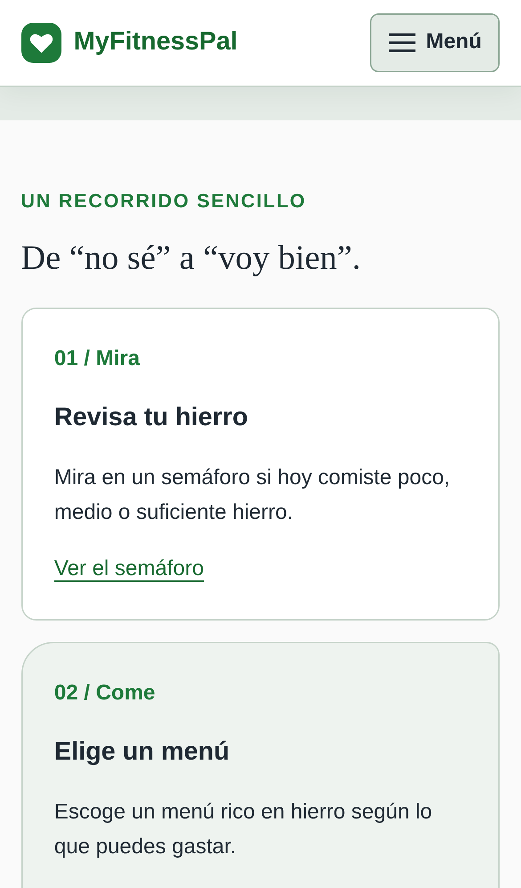 | 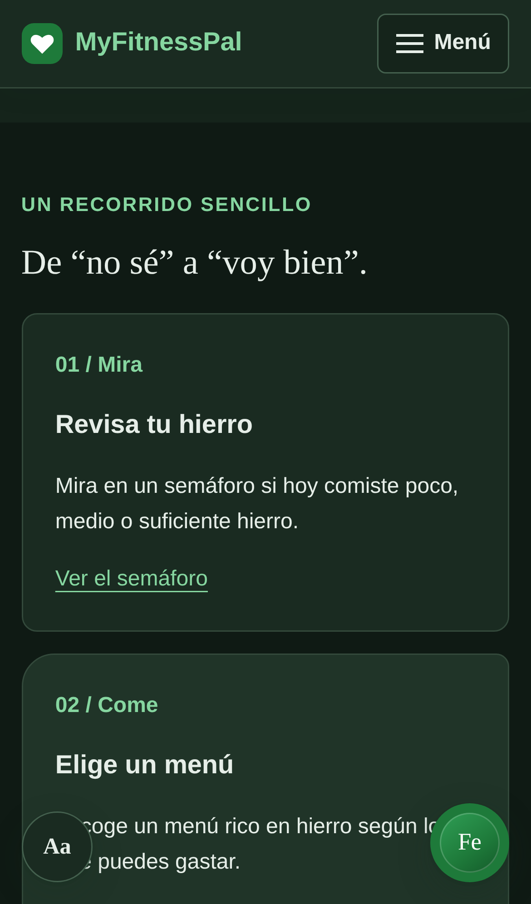 | 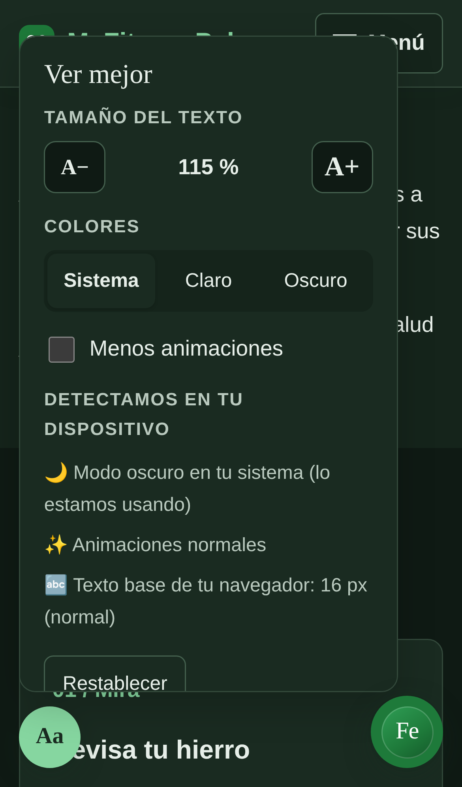 |

---

## Calidad de interacción (las 6 mejoras)
Se siguieron las skills de diseño de **emilkowalski/skills** (instaladas en `.claude/skills/`):
- solo se animan `transform` y `opacity`, con curvas *ease-out*;
- las salidas son más rápidas que las entradas;
- los botones tienen `:active` con escala y el *hover* solo aplica con mouse;
- las acciones con teclado no se animan;
- se respeta `prefers-reduced-motion`;
- los campos usan 16 px para que el celular no haga zoom.
